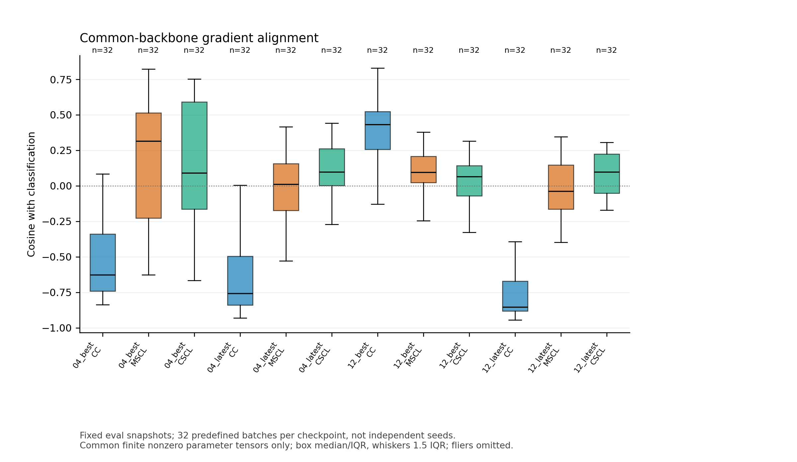
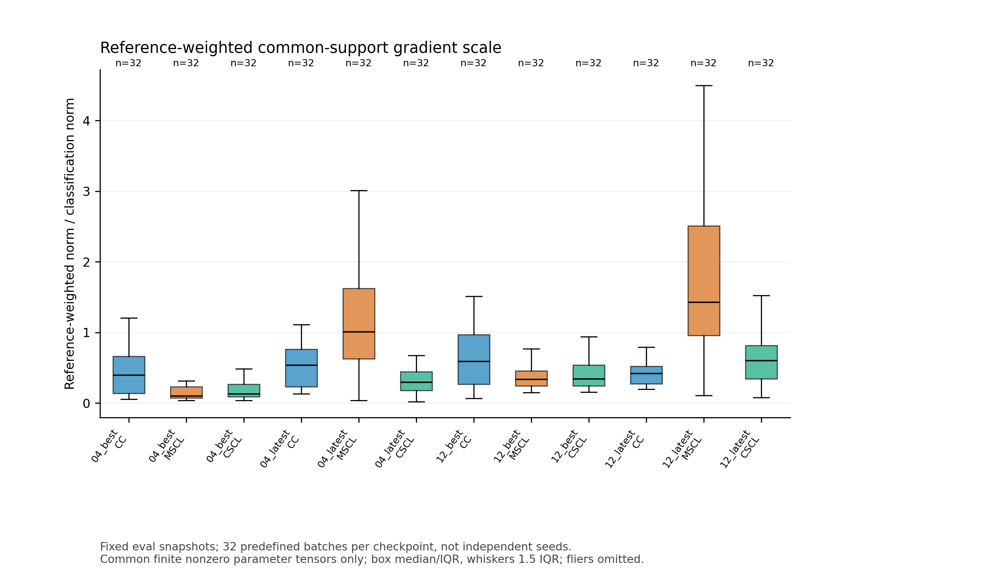
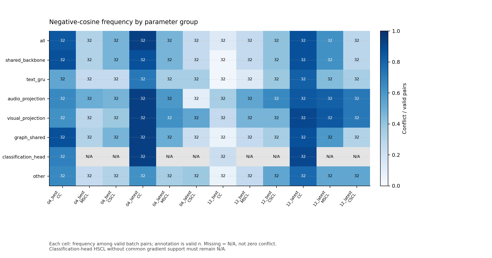
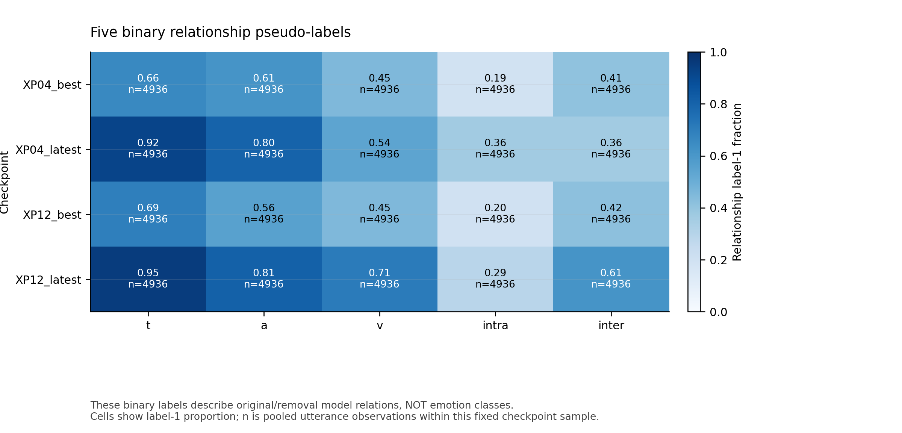
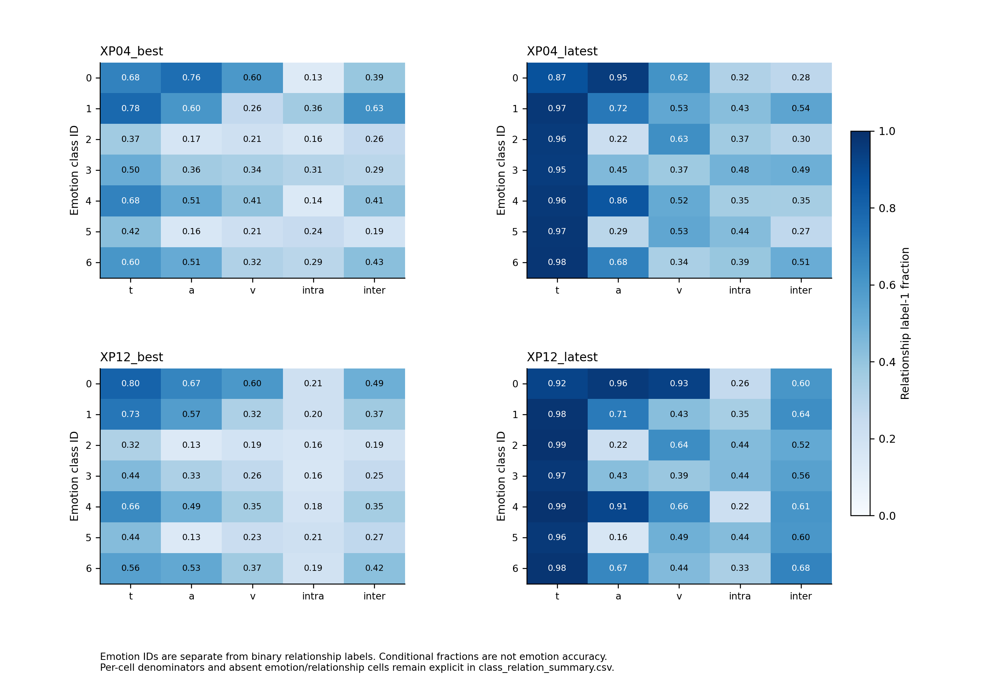
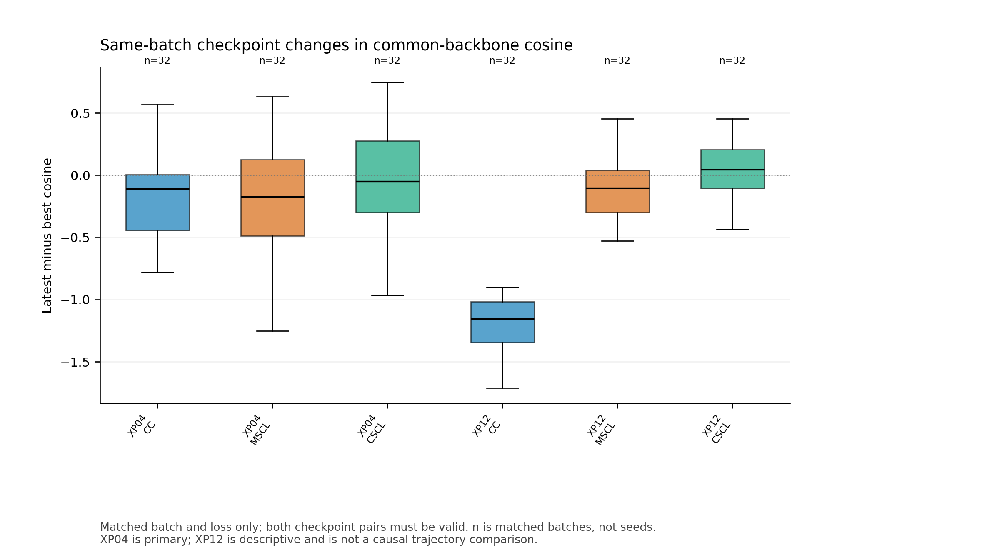
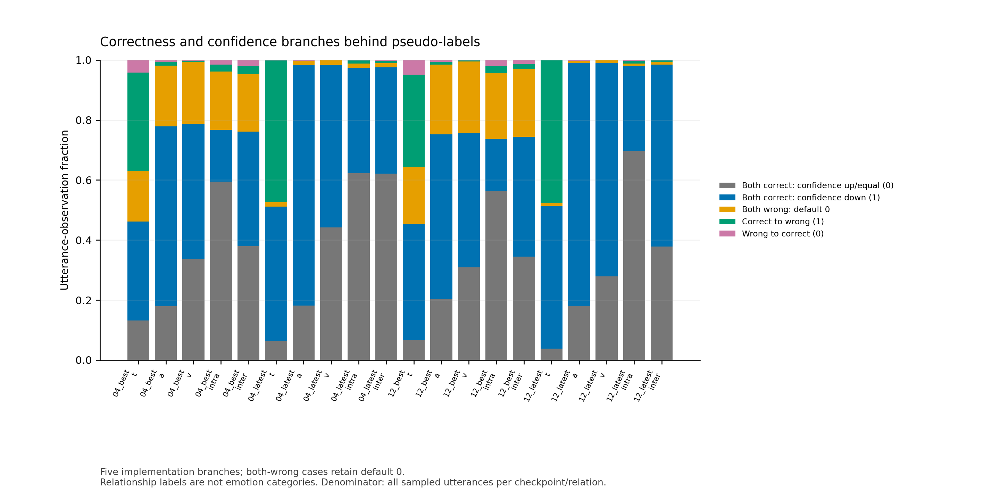
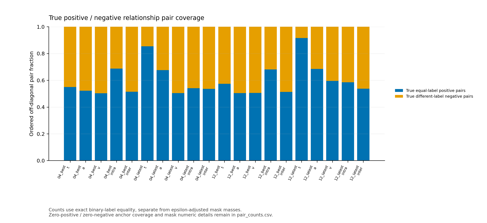
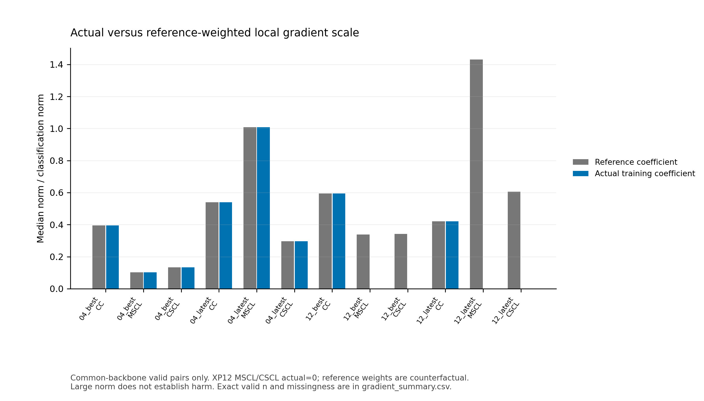

# CMERC辅助损失梯度冲突与伪标签质量诊断（XP13）

## 主要结论与下一步

**本组已完成并通过验收；未开展任何新训练、参数更新或测试集前向。** 四个真实Checkpoint在同一组32个训练Batch上完成128个诊断单元，768次模型前向、512次独立autograd.grad。观察到局部梯度竞争及二值关系标签的语义混杂/阶段偏移，尚不能据此确定论文F1差距的根因，也不支持直接宣称HSCL无效或CC有害。

**下一次最值得验证的单一机制：原始分类Loss与CC在不同真实类置信度下的目标方向关系。** 这是对实测冲突的机制核查建议，不是预登记筛选产生的唯一降权胜者。CC在XP04两个快照的共享主干均有28/32负余弦，但后期MSCL的加权范数比最高，原筛选规则明确返回`insufficient`。因此当前不选择新的最优系数、不启动五Seed，也不自动新增训练。

若安排后续最小训练，应先完成上述方向核查，再单独预登记一个损失系数与现有控制的验证集对照；数据、Seed、CL、模型、其他系数保持，测试仍隔离。现有证据不足以决定应降低CC还是MSCL，不把“范数大”当作选系数依据。不建议同时改伪标签和系数。

## 历史验证集背景及XP12现象

以下直接重算XP12归档中只含Train/Validation的40轮曲线；没有重新评估历史模型，也没有读取历史测试分数来作选择。

| 历史实验 | 最佳验证W-F1 | 最佳Epoch | 末10轮验证W-F1 | 末10轮验证分类Loss |
|---|---:|---:|---:|---:|
| XP04_full | 65.24% | 8 | 62.909% | 5.1819 |
| XP06_wo_cc | 65.77% | 8 | 62.766% | 4.6339 |
| XP12_wo_hscl | 65.69% | 5 | 62.794% | 5.1431 |

XP12最佳值比XP04高0.45个百分点，但末10轮低0.115个百分点。关闭HSCL不保证后期持续改善：在XP12第40轮，实际辅助目标只剩CC，其共享主干仍有28/32负余弦；原分类目标、过拟合及其他泛化因素也没有被去除。这是与现象相容的推断，不是关闭HSCL造成/解决梯度冲突的因果证明。XP12最佳轮e5与XP04最佳轮e8并非等时点；XP12离线HSCL梯度只是反事实参考。

## 关键定量证据

共同有效参数支持上的共享主干统计（每项均32个有效Batch；范数比已经乘原系数，负余弦频率不能外推整个历史训练）：

| XP04快照 | 项 | 负余弦Batch | cos中位数 | 加权梯度/分类梯度范数比中位数 |
|---|---|---:|---:|---:|
| XP04_best | cc | 28/32（87.50%） | -0.6277 | 0.3953 |
| XP04_best | mscl | 10/32（31.25%） | 0.3163 | 0.1022 |
| XP04_best | cscl | 15/32（46.88%） | 0.0914 | 0.1335 |
| XP04_best | aux_actual_sum | 29/32（90.62%） | -0.5248 | 0.5720 |
| XP04_latest | cc | 28/32（87.50%） | -0.7571 | 0.5394 |
| XP04_latest | mscl | 15/32（46.88%） | 0.0103 | 1.0078 |
| XP04_latest | cscl | 8/32（25.00%） | 0.0972 | 0.2967 |
| XP04_latest | aux_actual_sum | 25/32（78.12%） | -0.2168 | 1.2662 |

CC的冲突不只出现在主干：XP04 e40的分类头、音频投影、视觉投影与共享图模块各为30/32，文本GRU为23/32。e8共享图模块为28/32、文本GRU17/32。不能把不同组相加当独立样本。MSCL/CSCL对分类头没有共同梯度支持，记N/A；其冲突主要在表示层测量。完整逐层结果及梯度内积、raw/reference/actual范数见底层CSV。

XP04 e8五路both-wrong默认0占全部关系观测的16.96%–20.71%；其中移除文本关系的837个默认0里，682个真实类概率实际下降、155个上升。该默认0显然不统一表示“置信度上升”。e40文本关系77个默认0均伴随真实类概率下降；这只是分支语义事实，不将其称为情绪伪标签错误率。

文本关系label1从e8的65.70%变为e40的92.10%，音频从60.98%变为80.27%；上下文intra从19.37%变为36.14%。e40文本label0的Batch逆频率权重最大60.33，XP12 e40反事实路径最大181。类别比例与权重均会变化，但没有证据证明所有关系均缺正负对。

XP04 e40文本关系在3个Batch各有1个anchor缺真实同类正对；XP12 e40有4个，其他checkpoint/关系未见该缺对现象；640条关系数值审计均未见非有限logit，256次wrapper没有NaN/Inf回退。XP12 e40文本关系有65个anchor的neg加权和小于0，但pos+neg分母仍为正；不能把它误报为负分母或数值崩溃。

不同情绪类别的关系分布也不同：XP04 e40音频label1在情绪ID0为约0.95、ID2为约0.22；它们不是情绪准确率。真实类别置信度移除差值、主模型正确/错误条件下的分布、分支覆盖及关系Loss贡献均在聚合CSV中保留，避免只看总体比例。

## 分类目标的补充源码核查

[model_cm.py](../code_xp04/model_cm.py)第41–49行先令`pt=onehot*log_p`，但`fl`末尾仍乘完整`log_p`，最后对全部样本和类别求mean。对单话语的七类输出，其真实实现为：

$$L_{cls}=\frac{\alpha}{7}\left[-(1-\log p_y)^\gamma\log p_y-\sum_{j\ne y}\log p_j\right].$$

这里包含非真实类别的负对数概率惩罚，不能只按名称理解为仅目标类的Focal项。另一方面CC在满足移除后真实类log概率不低于学生的分支中（原代码包含相等），对学生施加提高真实类log概率的梯度；teacher分支no_grad。两者局部目标可以不同。该实现被Baseline及CMERC共同沿用，本组没有改公式；它本身不能单独证明CMERC相对Baseline收益缺失或论文差距来源。

待验证假设：高置信样本上原分类目标与CC的竞争可能解释部分负余弦。下一次先只读核查现有权重中按预登记真实类概率区间分层的目标方向，并区分单样本logit方向与共享参数聚合方向；不能由本批Batch余弦直接宣称该条件机制已成立。建议使用原公式、训练样本、无参数更新，不直接换成另一版FocalLoss。

## 完成范围、隐私及复核

选取512个不同训练对话、4936条话语，覆盖原训练池1038对话/9989话语的49.33%/49.41%，七类话语数依次为2315/607/134/347/850/135/548。只使用训练ID；未构建验证或测试诊断loader。固定输入分层重组影响padding、正负对和信息移除基准，eval模式及同步teacher也不同于历史在线训练。只有四个离散快照，不重建不存在的早期权重。

验收验证2302个历史文件和四Checkpoint未变，每个case的模型参数、BN等buffer、RNG及.grad状态前后一致。52项合成CPU检查覆盖采样、统计、运行守卫与分析；本组无新训练、无optimizer、无step、无Tensor.backward、无测试F1/ECE/CEL。独立审查及哈希记录可追溯。

原始冻结历史参考内嵌的划分ID列表仅保留服务器；公开副本删除ID并保留数量、原SHA和验证指标。实际采样ID、逐话语关系、预测、置信度、原权重和日志均不公开。公开哈希可审计来源，但克隆GitHub后缺外部权重/数据/私有采样清单不能直接重跑全部诊断。

9组PNG/SVG已人工检查；第7图原长图例被裁切，另存原图后通过独立纯排版脚本修复，输入CSV和冻结绘图脚本均未变，前后SHA单列。没有修改统计结果。

事实：局部梯度竞争、标签比例/默认0语义、现有数值及缺对计数。推断：辅助目标与分类目标可能在部分阶段竞争，标签覆盖变化可能影响HSCL。未证明：持续训练冲突的频率、模块的净因果损害、其他Seed/测试集收益、最优损失系数或论文差距的唯一根因。

[解释汇总](../results/interpretation_summary.json)、[历史验证对照](../results/historical_validation_comparison.csv)、[源码审计](../reports/SOURCE_AUDIT.md)、[独立验收](../provenance/final_verification.json)、[纯排版修复记录](../provenance/figure7_layout_revision.json)。

## 实测图表

### 共享主干余弦分布

[SVG](../results/figures/01_cosine_distributions.svg)

### 原系数加权梯度尺度

[SVG](../results/figures/02_reference_norm_ratios.svg)

### 参数组冲突比例及有效分母

[SVG](../results/figures/03_group_conflict_frequency.svg)

### 五路二值关系标签分布

[SVG](../results/figures/04_pseudo_label_proportions.svg)

### 情绪类别条件下的关系标签分布

[SVG](../results/figures/05_emotion_relationship_heatmap.svg)

### 同Batch快照差值

[SVG](../results/figures/06_paired_checkpoint_cosine_changes.svg)

### 标签条件分支覆盖

[SVG](../results/figures/07_pseudo_branch_coverage.svg)

### 真实同类/异类关系对比例

[SVG](../results/figures/08_relationship_pair_coverage.svg)

### 实际与反事实参考梯度尺度

[SVG](../results/figures/09_actual_reference_gradient_scale.svg)

## 冻结分析脚本生成的完整统计

### 快照统计明细

生成时间：2026-10-25T13:25:38.779765+00:00。固定四个Checkpoint×同一组32个训练Batch，共128个case；每case六次模型前向、最多四次独立autograd，eval+grad固定权重，无训练、无optimizer.step、无新增测试前向。

## 研究设计与证据边界

主要比较XP04 best第8轮与latest第40轮；XP12 w/o HSCL best第5轮与latest第40轮仅辅助描述。原训练teacher在epoch入口snapshot后固定，学生在该epoch多步更新；本次每Batch teacher=当前Checkpoint学生，无法还原历史stale teacher。eval关闭Dropout且固定BN。这里测量eval快照梯度，不能称为历史训练梯度；四个离散Checkpoint不是完整优化轨迹。XP12原训练HSCL实际权重为0，其raw HSCL离线梯度和reference 0.15/0.15只是反事实尺度对照，不代表XP12优化了HSCL。

采样规则预先固定：训练池按对话长度四分层、各8个Batch16，固定seed67137，在可用类别内贪心覆盖七情绪并随机补齐，不看性能/梯度/测试挑Batch。32个Batch不是32个独立Seed，不做p值或统计显著检验。长度分层重新组织Batch会改变HSCL正负集合、padding及原均值移除的输入；冲突频率仅对应这32个固定Batch，不是整个训练池/历史训练冲突频率的估计。采样代表性、单Seed、历史时点和eval模式均限制外推。公共文件只保留per-Batch或聚合，无原始对话ID、逐话语预测/置信度或raw梯度。

完成门禁：state completed，独立验收passed，case数128；实际forward=768、autograd=512，training_runs=0、optimizer_steps=0、test_forwards=0。设备为user23 GPU0（`GPU-7ff18ebb-100e-98fe-038b-a98bd4f94248`）；不将共享资源/离散采样解释为连续独占。

## 梯度方向、尺度和有效分母

每个pair只在共同参数Tensor上计算：双方Tensor均非None、有限且整Tensor范数非零，保留该Tensor全部坐标；不使用逐坐标交集。无共同支持、零、缺失和非有限分别记录，不填0cos。原core的ok/partial_support/partial_nonfinite在保留共同norm有限非零的检验后，由分析副本显式认证status=valid；source_status原样保留，原CSV不改。一个valid pair也可能排除了部分缺失/零/非有限Tensor，见原状态和排除计数。冲突定义cos<0，分母是该Checkpoint/项/组中有效Batch数，不是固定32或所有参数组之和。分类头没有HSCL梯度时明确N/A。

| Checkpoint | 辅助项 | 组 | valid/总Batch | 负cos数 | 冲突频率 | cos中位数 | reference加权norm/分类norm中位数 |
|---|---|---|---:|---:|---:|---:|---:|
| XP04_best | cc | all | 32/32 | 27 | 0.8438 | -0.4891 | 0.3872 |
| XP04_best | cc | classification_head | 32/32 | 22 | 0.6875 | -0.1168 | 0.3541 |
| XP04_best | cc | shared_backbone | 32/32 | 28 | 0.8750 | -0.6277 | 0.3953 |
| XP04_best | cscl | all | 32/32 | 15 | 0.4688 | 0.0914 | 0.1335 |
| XP04_best | cscl | classification_head | 0/32 | 0 | N/A | N/A | N/A |
| XP04_best | cscl | shared_backbone | 32/32 | 15 | 0.4688 | 0.0914 | 0.1335 |
| XP04_best | mscl | all | 32/32 | 10 | 0.3125 | 0.3163 | 0.1022 |
| XP04_best | mscl | classification_head | 0/32 | 0 | N/A | N/A | N/A |
| XP04_best | mscl | shared_backbone | 32/32 | 10 | 0.3125 | 0.3163 | 0.1022 |
| XP04_latest | cc | all | 32/32 | 30 | 0.9375 | -0.7995 | 0.5298 |
| XP04_latest | cc | classification_head | 32/32 | 30 | 0.9375 | -0.8134 | 0.4611 |
| XP04_latest | cc | shared_backbone | 32/32 | 28 | 0.8750 | -0.7571 | 0.5394 |
| XP04_latest | cscl | all | 32/32 | 8 | 0.2500 | 0.0972 | 0.2967 |
| XP04_latest | cscl | classification_head | 0/32 | 0 | N/A | N/A | N/A |
| XP04_latest | cscl | shared_backbone | 32/32 | 8 | 0.2500 | 0.0972 | 0.2967 |
| XP04_latest | mscl | all | 32/32 | 15 | 0.4688 | 0.0103 | 1.0078 |
| XP04_latest | mscl | classification_head | 0/32 | 0 | N/A | N/A | N/A |
| XP04_latest | mscl | shared_backbone | 32/32 | 15 | 0.4688 | 0.0103 | 1.0078 |
| XP12_best | cc | all | 32/32 | 4 | 0.1250 | 0.2883 | 0.5064 |
| XP12_best | cc | classification_head | 32/32 | 7 | 0.2188 | 0.1829 | 0.4476 |
| XP12_best | cc | shared_backbone | 32/32 | 1 | 0.0312 | 0.4317 | 0.5938 |
| XP12_best | cscl | all | 32/32 | 13 | 0.4062 | 0.0642 | 0.3429 |
| XP12_best | cscl | classification_head | 0/32 | 0 | N/A | N/A | N/A |
| XP12_best | cscl | shared_backbone | 32/32 | 13 | 0.4062 | 0.0642 | 0.3429 |
| XP12_best | mscl | all | 32/32 | 8 | 0.2500 | 0.0958 | 0.3379 |
| XP12_best | mscl | classification_head | 0/32 | 0 | N/A | N/A | N/A |
| XP12_best | mscl | shared_backbone | 32/32 | 8 | 0.2500 | 0.0958 | 0.3379 |
| XP12_latest | cc | all | 32/32 | 28 | 0.8750 | -0.8633 | 0.4230 |
| XP12_latest | cc | classification_head | 32/32 | 29 | 0.9062 | -0.8987 | 0.4441 |
| XP12_latest | cc | shared_backbone | 32/32 | 28 | 0.8750 | -0.8542 | 0.4200 |
| XP12_latest | cscl | all | 32/32 | 9 | 0.2812 | 0.0981 | 0.6064 |
| XP12_latest | cscl | classification_head | 0/32 | 0 | N/A | N/A | N/A |
| XP12_latest | cscl | shared_backbone | 32/32 | 9 | 0.2812 | 0.0981 | 0.6064 |
| XP12_latest | mscl | all | 32/32 | 20 | 0.6250 | -0.0369 | 1.4301 |
| XP12_latest | mscl | classification_head | 0/32 | 0 | N/A | N/A | N/A |
| XP12_latest | mscl | shared_backbone | 32/32 | 20 | 0.6250 | -0.0369 | 1.4301 |

上述norm比使用相同pair的共同参数支持；完整各Loss各组raw/reference/actual梯度范数与缺失/零/非有限Tensor数另见原始gradient_norms.csv和聚合norm_summary.csv。负cos仅说明该快照局部一阶方向相反，不证明持续损害；norm大不等于有害，正cos也不证明泛化收益。

同Batch Checkpoint差值（仅两侧都valid的pair；latest−best）：

| 配对 | 辅助项 | 组 | 有效配对n | cos变化中位数 | cos变化均值 |
|---|---|---|---:|---:|---:|
| XP04_best → XP04_latest | cc | shared_backbone | 32 | -0.1091 | -0.1121 |
| XP04_best → XP04_latest | cscl | shared_backbone | 32 | -0.0503 | -0.0093 |
| XP04_best → XP04_latest | mscl | shared_backbone | 32 | -0.1746 | -0.2114 |
| XP12_best → XP12_latest | cc | shared_backbone | 32 | -1.1550 | -1.0464 |
| XP12_best → XP12_latest | cscl | shared_backbone | 32 | 0.0445 | 0.0439 |
| XP12_best → XP12_latest | mscl | shared_backbone | 32 | -0.1041 | -0.1175 |

同Batch匹配去掉缺失一侧，不以不匹配Batch替代。XP12轨迹变化不能归因为单独关闭HSCL：其权重轨迹不同，且诊断teacher与历史训练teacher不同。

## 五路二值关系伪标签与条件分支

t/a/v/intra/inter均是移除前后模型关系标签，不是七类情绪标签。初始化0；主错/移除对为0，主对/移除错为1；二者都对时依真实类别置信度变化判0/1；二者都错保留默认0。因此0不一定表示正确反事实证据，必须连同both_wrong_default0与置信度正/负/相等的条件覆盖解释。

| Checkpoint | 关系 | label0数 | label1数 | label1比例 | both-wrong默认0数 | 默认0占全部 |
|---|---|---:|---:|---:|---:|---:|
| XP04_best | a | 1926 | 3010 | 0.6098 | 1005 | 0.2036 |
| XP04_best | inter | 2913 | 2023 | 0.4098 | 946 | 0.1917 |
| XP04_best | intra | 3980 | 956 | 0.1937 | 964 | 0.1953 |
| XP04_best | t | 1693 | 3243 | 0.6570 | 837 | 0.1696 |
| XP04_best | v | 2703 | 2233 | 0.4524 | 1022 | 0.2071 |
| XP04_latest | a | 974 | 3962 | 0.8027 | 63 | 0.0128 |
| XP04_latest | inter | 3147 | 1789 | 0.3624 | 70 | 0.0142 |
| XP04_latest | intra | 3152 | 1784 | 0.3614 | 73 | 0.0148 |
| XP04_latest | t | 390 | 4546 | 0.9210 | 77 | 0.0156 |
| XP04_latest | v | 2265 | 2671 | 0.5411 | 81 | 0.0164 |
| XP12_best | a | 2184 | 2752 | 0.5575 | 1152 | 0.2334 |
| XP12_best | inter | 2886 | 2050 | 0.4153 | 1119 | 0.2267 |
| XP12_best | intra | 3966 | 970 | 0.1965 | 1085 | 0.2198 |
| XP12_best | t | 1513 | 3423 | 0.6935 | 944 | 0.1912 |
| XP12_best | v | 2711 | 2225 | 0.4508 | 1177 | 0.2385 |
| XP12_latest | a | 942 | 3994 | 0.8092 | 38 | 0.0077 |
| XP12_latest | inter | 1919 | 3017 | 0.6112 | 45 | 0.0091 |
| XP12_latest | intra | 3490 | 1446 | 0.2929 | 38 | 0.0077 |
| XP12_latest | t | 238 | 4698 | 0.9518 | 51 | 0.0103 |
| XP12_latest | v | 1428 | 3508 | 0.7107 | 51 | 0.0103 |

情绪×关系热图按emotion_class独立分层，展示关系label1比例而非情绪准确率。confidence_aggregate.csv保留subset条件下的主/移除真实类概率均值、差值和正/负/相等计数；其均值按subset话语数加权，不能与无条件均值混用。

## CKSCL正负对、权重和数值路径

原clloss.py的CKSCL_base先归一化features、temperature=0.07；相等关系标签mask加1e−7，再去对角。故同类positive权重1+epsilon、同类negative权重−epsilon；异类positive权重epsilon、negative权重1−epsilon。这些是数学写法，FP32舍入后的实际mask值由审计CSV保留。epsilon加在关系mask，不是最终分母的通用稳定项。正负对数量按真实关系相等/不等的有序非对角pair报告，与带epsilon的有效权重质量分开；zero-positive/negative-anchor比例不能从总正负pair数猜测。

create_class_weight_SCL采用当前Batch二值关系类别逆频率n/n_c，而非情绪类别权重。CKSCL_tav/context把各关系logit乘对应类别权重，求和后按N话语取负均值；MSCL包含三关系，CSCL包含两关系，二者原始尺度不能只按单一关系直接比较。原wrapper遇非有限Loss返回零的fallback与真实zero梯度分开记录。不得把fallback或无梯度当作“损失未执行”。

数值与fallback计数（按Checkpoint/原wrapper/Batch去重）：

| Checkpoint | 项 | wrapper Batch数 | fallback数 |
|---|---|---:|---:|
| XP04_best | cscl | 32 | 0 |
| XP04_best | mscl | 32 | 0 |
| XP04_latest | cscl | 32 | 0 |
| XP04_latest | mscl | 32 | 0 |
| XP12_best | cscl | 32 | 0 |
| XP12_best | mscl | 32 | 0 |
| XP12_latest | cscl | 32 | 0 |
| XP12_latest | mscl | 32 | 0 |

原CKSCL_base实际局部数值审计（按同组32个Batch累积计数；极值保留有限记录，非有限单列）：

| Checkpoint | 关系 | anchor总数 | 非有限logit | 非有限相似度cell | 负mask cell | neg<0 anchor | pos+neg<0 anchor | 零/非有限分母 | pos范围 | neg范围 |
|---|---|---:|---:|---:|---:|---:|---:|---|---|---|
| XP04_best | a | 4936 | 0 | 0 | 526618 | 0 | 0 | 0/0 | 3023.5220–14075182.0000 | 450.9407–14428646.0000 |
| XP04_best | inter | 4936 | 0 | 0 | 518846 | 0 | 0 | 0/0 | 15840.1797–17844544.0000 | 1854.1018–12881174.0000 |
| XP04_best | intra | 4936 | 0 | 0 | 693526 | 0 | 0 | 0/0 | 2899.3230–19416482.0000 | 73.8337–15638207.0000 |
| XP04_best | t | 4936 | 0 | 0 | 554212 | 0 | 0 | 0/0 | 11399.3164–16862056.0000 | 170.0615–16795816.0000 |
| XP04_best | v | 4936 | 0 | 0 | 507484 | 0 | 0 | 0/0 | 9026.5273–12429196.0000 | 8667.7539–14741104.0000 |
| XP04_latest | a | 4936 | 0 | 0 | 681692 | 0 | 0 | 0/0 | 14.5752–12533342.0000 | 4.4243–9717481.0000 |
| XP04_latest | inter | 4936 | 0 | 0 | 540322 | 0 | 0 | 0/0 | 1162.9397–10792310.0000 | 41.9252–8125854.0000 |
| XP04_latest | intra | 4936 | 0 | 0 | 546252 | 0 | 0 | 0/0 | 26943.8320–12539496.0000 | 10719.3799–11207699.0000 |
| XP04_latest | t | 4936 | 0 | 0 | 861882 | 0 | 0 | 0/0 | 0.0515–15456157.0000 | 0.8979–7542257.0000 |
| XP04_latest | v | 4936 | 0 | 0 | 508382 | 0 | 0 | 0/0 | 29499.0430–9694026.0000 | 10613.1328–8910930.0000 |
| XP12_best | a | 4936 | 0 | 0 | 508478 | 0 | 0 | 0/0 | 188.7646–20236546.0000 | 58.6754–18876952.0000 |
| XP12_best | inter | 4936 | 0 | 0 | 518180 | 0 | 0 | 0/0 | 5.2825–24468256.0000 | 13.1951–21061368.0000 |
| XP12_best | intra | 4936 | 0 | 0 | 687082 | 0 | 0 | 0/0 | 0.4102–24698472.0000 | 2.1654–21640788.0000 |
| XP12_best | t | 4936 | 0 | 0 | 579002 | 0 | 0 | 0/0 | 159.9003–27669326.0000 | 7.4768–19171790.0000 |
| XP12_best | v | 4936 | 0 | 0 | 509534 | 0 | 0 | 0/0 | 21.7384–22715456.0000 | 71.2834–19782092.0000 |
| XP12_latest | a | 4936 | 0 | 0 | 690798 | 0 | 0 | 0/0 | 2.7772–18791052.0000 | 5.8430–16911288.0000 |
| XP12_latest | inter | 4936 | 0 | 0 | 541654 | 0 | 0 | 0/0 | 75.2241–16295493.0000 | 85.0445–16070702.0000 |
| XP12_latest | intra | 4936 | 0 | 0 | 590708 | 0 | 0 | 0/0 | 8.1838–17036400.0000 | 39.5797–13684753.0000 |
| XP12_latest | t | 4936 | 0 | 0 | 924206 | 65 | 0 | 0/0 | 0.0471–19808298.0000 | -0.5701–14451819.0000 |
| XP12_latest | v | 4936 | 0 | 0 | 600156 | 0 | 0 | 0/0 | 58.0781–19528498.0000 | 35.3192–13969153.0000 |

负neg和（负对加权质量）不等于log比值的负分母：分母严格为pos+neg，负/零/非有限分母与neg<0独立计数，不混称。逆频率权重按每Batch中该关系类别存在时统计；缺失类别Batch单列，不当零权重观测混入。权重分布和条件confidence/贡献可用于提出标签覆盖假设，但不直接等于伪标签正确率。见[class_weight_summary.csv](../results/class_weight_summary.csv)。

各关系positive/negative数量、zero-anchor、epsilon mask质量、n/nc权重、条件confidence与分层contribution见底层CSV；contribution_sum已经含原1/N，不二次除N。contribution_aggregate.csv只取stratum=all；有非有限Batch则完整目标均值保留N/A，有限子集均值单独标记。分层可能重叠，不能跨all/类别/branch直接求和。CKSCL实际pos/neg/logit数值聚合和wrapper审计单独保存，分析不替代原计算。

## 事实、推断与下一研究优先级

已证实事实：固定case覆盖、数值有效/缺失分母、上述离散快照方向/尺度、二值关系覆盖及原数学路径审计。尚未证实：某辅助Loss持续损害分类、伪标签等价于情绪质量、降低系数可获益、对其他Seed或测试集成立、论文差距的唯一根因。

**描述性筛选：** 方向冲突与加权尺度排序未在两个XP04快照集中到同一项；证据不足以唯一选CC/MSCL/CSCL或系数。

**下一步：** 当前证据不足以唯一优先CC/MSCL/CSCL或给出新系数；先结合有效分母、默认0条件覆盖和局部数值审计提出可证伪假设，再单独登记。

筛选规则预先写入脚本：仅当同一项在XP04 best/latest均具有最高共同主干冲突率和最高reference加权norm比，且三项均有32个有效Batch时，才列为描述性优先检查。规则不等于优化决策或统计强证据。本批不训练、不step、不测试，不自动修改Loss公式/系数、追加Seed或开展五Seed。

本阶段零新增测试前向，未计算ECE/CEL；历史字段偶然访问已在先前阶段披露，不声称整个项目从未接触历史测试字段。本分析只读取本批公共聚合CSV，不读取private、混合旧summary、final_test或预测数组。作者课程生成史未知等前序来源限制仍保留。

## 交付与可追溯性

[预登记](../reports/PREREGISTRATION.md)、[配置](../configs/registry.json)、[Checkpoint清单](../preflight/checkpoint_inventory.json)、[图契约](../provenance/figure_contract.md)、[独立验收](../provenance/final_verification.json)、[汇总](../results/metrics_summary.json)、[9图18文件及SHA](../results/figures/manifest.json)。

[梯度方向聚合](../results/gradient_summary.csv)、[梯度范数聚合](../results/norm_summary.csv)、[同Batch配对](../results/paired_checkpoint_deltas.csv)、[伪标签聚合](../results/pseudo_summary.csv)、[分支聚合](../results/branch_summary.csv)、[条件置信度](../results/confidence_aggregate.csv)、[采样覆盖](../results/sample_coverage.csv)、[模型/RNG状态哈希审计](../results/state_audit.csv)、[原CKSCL局部数值](../results/ckscl_numeric.csv)、[原wrapper回退](../results/ckscl_wrapper_audit.csv)。
