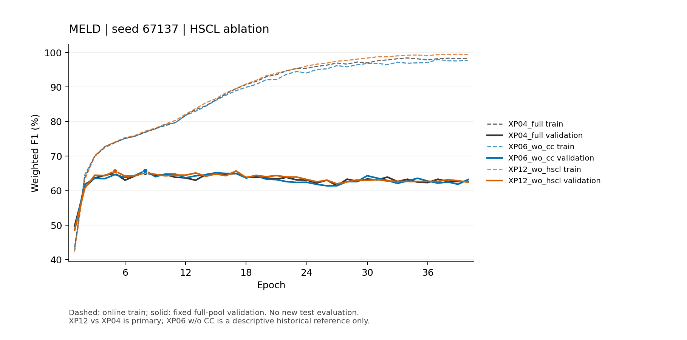
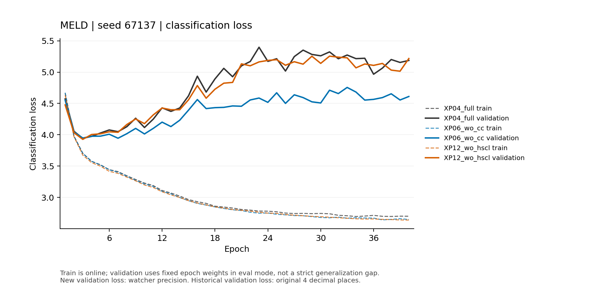
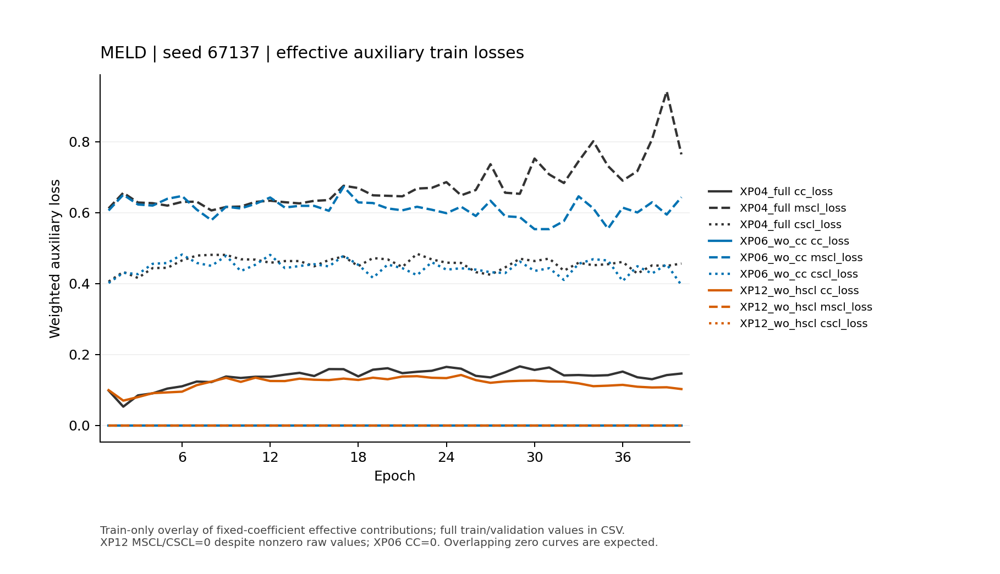

# CMERC HSCL消融诊断报告

生成时间：2026-10-25T09:03:58.408937+00:00。本批仅新增MELD seed67137 w/o HSCL完整40轮1次训练。XP04完整CMERC为主要历史控制；XP06 w/o CC仅作为已有描述性参照，不是本批新增训练，也不将XP12与XP06差异解释为单变量效应。

**主要判定：** `mixed_incomplete`。最佳提高但末段下降或不变，证据混合/不足；暂缓第二Seed及五Seed扩展，先解释已有轨迹，不更换Seed或按测试择优。

## 科学设置、源码开关与选模

唯一登记科学改动：contrastlearning=True→False；保留calibrate=True、courselearning=True。dropout=0.4、rec_dropout CLI元数据0.1、MELD seed67137、split_seed1475、lr=0.0001、L2=0.00003、Adam、Batch16/16、40 epochs、GRU/ATen、hyper/direct/concat_DHT、BN、L3/K3、CC系数0.002、MSCL/CSCL登记系数0.15/0.15、CL epoch_ratio0.4/scheduler_steps1、continuous RNG与capacity_safe保持XP04。工程skip_final_test=True取消最终测试，不改变训练数学。

train_cm.py:656使用contrastlearning or calibrate控制共享分支。本批CC仍开，故:669–675的五个移除辅助前向、:689–707的CC、:708–771的伪标签及原始MSCL/CSCL仍执行；原始HSCL不应伪造为零。:236–259仅按实际开关组合目标，关闭HSCL后effective MSCL=CSCL=0，总Loss=classification+0.002×rawCC。:1270课程学习独立控制，未因关闭HSCL而关闭CL。辅助teacher保持epoch入口快照/eval，网络和Loss公式未修改。

HSCL主要是确定性张量计算，采样使用固定private RNG，但这不等于已经证明所有随机调用与全程RNG轨迹匹配。只依据实际预检/首Batch审计报告初始化、RNG和梯度证据；关闭目标项会改变后续参数与预测，不要求后续数值轨迹相同，也不人为改源码强制RNG。

train_cm.py SHA256 `0fb27f08bdfd6fabe176eb7b717587fb5e7025ba94c6e3c191b01dc18168d3a2`；来源`/data2/yb/paper/lyx-msa/CMERC/experiments/dropout_second_seed_confirmation/20261025T052219Z/code_xp04`，与11组12个源码字节相同标记`True`；Git HEAD `a1be17557db7455219339aabf65e930f2c0ec7c5`。

Python 3.10.13、PyTorch 1.13.1+cu117、CUDA build 11.7、PyG 2.4.0，复用环境、无新增依赖。

选模为完整固定validation池话语级汇总W-F1，百分比round2后严格提高才保存，最高并列取首次，不是Batch F1平均。末段固定31–40轮均值，时间窗SD使用ddof=1，不是跨Seed波动或统计显著证据。positive要求最佳和末段均严格提高；最佳升而末段降或不变为mixed_incomplete；最佳未升为no_best_improvement。

## 三臂实际训练/验证结果

| 实验 | CC / calibrate | HSCL优化 / contrastlearning | CL / courselearning |
|---|---|---|---|
| XP04 完整CMERC | 开 / True | 开 / True | 开 / True |
| XP06 w/o CC（描述） | 关 / False | 开 / True | 开 / True |
| XP12 w/o HSCL（本次） | 开 / True | 关 / False | 开 / True |

| 臂 | 最佳val W-F1 % | Epoch | 末10轮val W-F1 % | 末段SD | 最佳轮val ACC % | 末段val ACC % | 最佳轮val Macro-F1 % |
|---|---:|---:|---:|---:|---:|---:|---:|
| XP04_full | 65.24 | 8 | 62.909 | 0.4975 | 66.28 | 64.245 | 未记录 |
| XP06_wo_cc | 65.77 | 8 | 62.766 | 0.6068 | 66.82 | 64.164 | 未记录 |
| XP12_wo_hscl | 65.69 | 5 | 62.794 | 0.2356 | 66.91 | 64.308 | 52.8336 |

| 相对XP04完整模型 | 用途 | 最佳变化 pp | 末段变化 pp | 判据 |
|---|---|---:|---:|---|
| XP12_wo_hscl | primary | +0.45 | -0.115 | mixed_incomplete |
| XP06_wo_cc | descriptive_only | +0.53 | -0.143 | 仅描述，不做候选判定 |

单Seed不作显著性检验；验证峰值与末段是同一相关轨迹的两个摘要，不当独立重复证据。XP06历史运行设备/时点与本批不同，且干预因素不同，描述性列不提供“CC优于/劣于HSCL”的严格归因。

## Loss、梯度与训练/验证轨迹

| 臂 | train分类Loss 最佳→末段 | val分类Loss 最佳→末段 | 实际optimizer.step | 梯度异常Epoch |
|---|---|---|---|---|
| XP04_full | 3.3453 → 2.7067 | 4.1291 → 5.1819 | 未记录；CPU重建2548 | 历史未记录 |
| XP06_wo_cc | 3.3378 → 2.6644 | 4.0173 → 4.6339 | 未记录；CPU重建2548 | 历史未记录 |
| XP12_wo_hscl | 3.4994 → 2.6572 | 4.0150 → 5.1431 | 2548 | 0 |

训练原始Loss（最佳验证轮→末10轮均值）：

| 臂 | 分类 | CC | MSCL | CSCL | 总Loss |
|---|---|---|---|---|---|
| XP04_full | 3.3453 → 2.7067 | 60.8713 → 71.5387 | 4.0387 → 5.0568 | 3.2041 → 3.0096 | 4.5534 → 4.0597 |
| XP06_wo_cc | 3.3378 → 2.6644 | 59.5721 → 80.3330 | 3.8556 → 4.0138 | 2.9969 → 2.9157 | 4.3656 → 3.7039 |
| XP12_wo_hscl | 3.4994 → 2.6572 | 46.3654 → 56.2678 | 4.6407 → 8.9080 | 3.1373 → 3.4505 | 3.5921 → 2.7698 |

验证原始Loss（最佳验证轮→末10轮均值）：

| 臂 | 分类 | CC | MSCL | CSCL | 总Loss |
|---|---|---|---|---|---|
| XP04_full | 4.1291 → 5.1819 | 未记录 → 未记录 | 未记录 → 未记录 | 未记录 → 未记录 | 未记录 → 未记录 |
| XP06_wo_cc | 4.0173 → 4.6339 | 未记录 → 未记录 | 未记录 → 未记录 | 未记录 → 未记录 | 未记录 → 未记录 |
| XP12_wo_hscl | 4.0150 → 5.1431 | 29.3321 → 44.1329 | 5.4004 → 4.8757 | 5.7658 → 4.6292 | 4.0737 → 5.2314 |

本批raw MSCL/CSCL实测非零批次数为{'mscl_loss': 2548, 'cscl_loss': 2548}，有效加权HSCL全部0；每个实际Batch核对目标class+0.002CC。旧档案validation辅助/总Loss未记录，保持None而不是填零。新臂分类Loss取watcher高精度均值，历史validation分类Loss仅4位小数日志。各项effective loss保存在loss_curves.csv；完整训练/验证W-F1、ACC、分类与总Loss以及raw/effective辅助Loss在图和CSV中。

- XP04_full：最佳验证轮→末段，train分类Loss -0.6386，val分类Loss +1.0528，val W-F1 -2.3310 pp。
- XP06_wo_cc：最佳验证轮→末段，train分类Loss -0.6733，val分类Loss +0.6166，val W-F1 -3.0040 pp。
- XP12_wo_hscl：最佳验证轮→末段，train分类Loss -0.8422，val分类Loss +1.1281，val W-F1 -2.8960 pp。

train为在线训练态、val为固定epoch权重eval，不把二者差当严格泛化gap。train Loss下降同时val Loss上升/验证末段回落仅为过拟合或目标竞争线索；W-F1与Loss方向不一致时不宣称已解决过拟合。有限梯度和更新只证明数值执行，不排除伪目标质量或泛化问题。首Batch梯度审计仅预检额外autograd.grad，不是正式训练的新算法，也不能代替多Seed机制证据。


### 对混合证据的解释和下一步最小工作

**已证实的方向差异：** XP12最佳验证W-F1提高0.450个百分点，但最佳轮从8提前到5，末10轮均值下降0.115个百分点。时间窗SD从0.497537降到0.235570，说明该固定窗口内波动更小；最佳至末段回落却从2.331扩大到2.896个百分点，增加0.565。更低波动不能替代均值或预登记双升条件，也不能单凭这些相关摘要证明优化更稳定。

末段训练分类Loss从2.70667967降至2.65724834，验证分类Loss从5.18186降至5.14309691（约−0.03876309；旧验证日志精度为4位小数）。验证F1末段却略降，表明Focal分类Loss与离散argmax后的Weighted F1并不单调对应；不能把Loss改善等同于主指标改善，更不能推断未计算的ECE/CEL或测试收益。训练末段W-F1达到99.200%，高于控制98.129%；从本臂最佳轮到末段仍表现为train分类Loss下降而validation分类Loss上升1.1281，过拟合迹象并未消失。

**CC仍实际生效：** 非正式首Batch证实CC梯度达到文本GRU与模态投影，raw CC梯度L2约1589.1644、backbone部分约207.8765，主分类梯度L2约15.7839；这些范数仅描述该Batch，不代表全程梯度竞争。正式每步验证有效CC贡献为0.002×raw CC；最佳轮和末段训练加权CC分别约0.092731和0.112536，均非零。原始MSCL/CSCL仍计算且本次2548步均非零，但两项有效权重始终0，额外梯度审计仅在probe进行，正式额外次数0。不同臂总Loss包含的目标项不同，不能仅以XP12总Loss数值更低宣称优化更好。

**有证据支持但未隔离的推断：** 当前结果提供“HSCL可能影响早期峰值与后期正则化权衡”的线索；不满足本轮积极证据门槛。没有直接测量HSCL梯度与分类梯度的夹角、伪标签质量或按类别贡献，不能断言HSCL与分类目标冲突，更不能断言HSCL无效。联合关闭MSCL和CSCL也不能分辨二者各自净影响。

**下一步建议（未执行）：** 暂缓第二Seed和最终五Seed，不凭本次混合结果直接降低两项HSCL系数。若后续另行登记，最小工作可先固定训练/验证Batch与Checkpoint，审计MSCL/CSCL伪标签分布及其与分类目标的梯度方向；再决定是否提出只改一个系数的窄范围验证假设。若未来要推广为配置收益，仍需独立Seed和同协议配对验证；本批不追加训练、权重搜索、w/o CL或测试。

源码定位按本次冻结副本：MELD FocalLoss为train_cm.py:1211，Adam为:1225，CL比例分支为:1270–1273、loader为:1282–1293。冻结审计表部分后半段行号沿用XP04原文件，因已有skip-final-test工程补丁偏移4行，详见[行号勘误](../provenance/source_line_reference_corrections.json)；源代码、科学配置与冻结判据均未改变。

### 主要训练曲线







## 预检、资源和完整验收

本批实际设备 user23 GPU0（`GPU-7ff18ebb-100e-98fe-038b-a98bd4f94248`）；XP04同Seed控制为GPU0 UUID GPU-7ff18ebb-100e-98fe-038b-a98bd4f94248，同物理卡。共享资源、历史时点及CUDA scatter非确定性限制严格因果和速度解释，不宣称连续独占。准入free>=3000MiB/util<=95%，3次间隔10秒，外部PID只披露、不终止。

独立验收`passed`，本批唯一40train/40validation/test0，实际训练Batch 2548；best/latest为第5/40轮，模型/Adam有限且Python/NumPy/Torch/CUDA RNG完整，核对实际args/provenance、源/数据与采样顺序，历史保全2166文件。

资源证据`limited`：247次采样，既有共驻PID样本247次、新PID样本0次、查询错误0次，正式最低空闲9595MiB/最大利用率84%；离散采样不能证明全程资源隔离。

首Batch预检标量审计摘要（只有实际保存的字段，完整梯度/RNG证据见链接；只比较本批同一wo-HSCL probe与正式首步，不含额外full-HSCL probe，未与XP04历史初始化/RNG逐位配对）：

```json
{
  "first.json": {
    "initial_model_sha256": "bae890a3045955522ca88978adfe7efc5e765ad1cd26b49afbae45276a4fa162",
    "rng_before_train": "858a766f250f173fb74c223f23dd430725d4796405461e8ef8ded8ea12ae3f32",
    "rng_before_step": "0cb5cf4fa84eea8eb13550f995c20ad76aa31fddcd478128b7c6046099151089",
    "rng_after_step": "0cb5cf4fa84eea8eb13550f995c20ad76aa31fddcd478128b7c6046099151089",
    "gradient_l2": 18.638935278447033,
    "gradients_finite": true,
    "optimizer_updated_parameters": true,
    "model_after_step_sha256": "c4d25d9bb21f0c643f7ae0fc165b783b5c26106a768ab30dac49f2aeca5e84e7"
  },
  "gradient_audit.json": {
    "status": "passed",
    "preflight_only": true,
    "additional_model_forwards": 0,
    "parameter_grad_buffers_unchanged": true,
    "rng_before": "0cb5cf4fa84eea8eb13550f995c20ad76aa31fddcd478128b7c6046099151089",
    "rng_after": "0cb5cf4fa84eea8eb13550f995c20ad76aa31fddcd478128b7c6046099151089",
    "CC_backbone_gradient_nonzero": true,
    "total_equals_classification_plus_0p002_CC_gradient": true,
    "compared_parameters": 44,
    "maximum_absolute_gradient_difference": 2.384185791015625e-07,
    "relative_tolerance": 0.0001,
    "absolute_tolerance": 1e-05,
    "MSCL_gradient_wrt_total": null,
    "CSCL_gradient_wrt_total": null,
    "limit": "First probe batch only; this does not assert nonzero CC gradients in every formal batch."
  },
  "probe_vs_formal_first_batch_exact_identity": {
    "initial_model_sha256": true,
    "rng_before_train": true,
    "rng_before_step": true,
    "rng_after_step": true,
    "dialogue_ids": true,
    "lengths": true
  },
  "gradient_l2": {
    "classification": 15.783873743530553,
    "cc": 1589.1644095956517,
    "total": 18.638935264173533,
    "cc_backbone": 207.87647455783988
  }
}
```

## 测试与来源透明边界

本次零新增test loader遍历/零新增测试前向，未计算ECE/CEL，不根据测试选择配置或Epoch。原综合pickle与test loader元数据仍载入，零前向不等于完全未接触含测试数据的文件。历史XP06 README初读曾可见旧测试列，访问说明只记录事件、不引用数值，见[历史指标访问说明](../provenance/historical_metric_access_note.json)；不宣称“全程未读旧测试”。本分析仅读取净化训练/验证refs及本次记录，绝不读取历史mixed summary、final_test或预测数组。

作者fixed_author课程包含validation键且生成史未知；同输入配对不等于全链条validation-free。代码、历史Checkpoint、日志、结果均不覆盖。

## 已证实事实、推断和下一步

已证实：实际开关/数据/选模、40轮轨迹、原始Loss保留而有效HSCL置零、完整验收与数值执行。尚未证实：HSCL就是论文F1差距唯一根因、其伪标签质量、跨Seed普遍改善或测试泛化。若正向，仅支持该Seed消融线索；若无主指标提高，也不能断言HSCL在所有配置均无作用。

**直接建议：** 最佳提高但末段下降或不变，证据混合/不足；暂缓第二Seed及五Seed扩展，先解释已有轨迹，不更换Seed或按测试择优。 本批不自动启动w/o CL、第二Seed、五Seed、其他超参数或测试。

[预登记](../reports/PREREGISTRATION.md)、[源码协议审计](../reports/SOURCE_AND_PROTOCOL_AUDIT.md)、[配置](../configs/registry.json)、[源码来源](../provenance/source_origin.json)、[环境](../provenance/environment.json)、[冻结](../provenance/frozen_execution.json)、[XP04净化refs](../provenance/xp04_validation_references.json)、[XP06净化refs](../provenance/xp06_validation_reference.json)、[容量预检](../preflight/capacity_cpu.json)、[预检门禁](../preflight/gate.json)、[梯度审计](../preflight/MELD_wo_hscl_seed67137/observer/gradient_audit.json)、[完整验收](../provenance/final_verification.json)。

[per_run.csv](../results/per_run.csv)、[comparison.csv](../results/comparison.csv)、[metrics_summary.json](../results/metrics_summary.json)、[curves.csv](../results/curves.csv)、[loss_curves.csv](../results/loss_curves.csv)、[9图18文件及SHA](../results/figures/manifest.json)。

实验根目录：`/data2/yb/paper/lyx-msa/CMERC/experiments/hscl_ablation_validation/20261025T080937Z`。仓库根报告正文相同，相对链接按位置调整。
