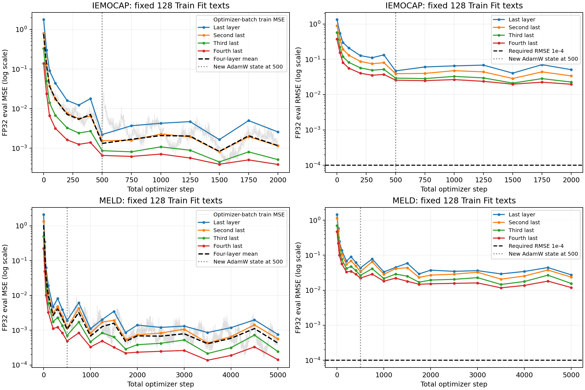

# XP04 RoBERTa 小样本蒸馏延长实验

本轮完成两个独立的固定128条Train Fit实验。原500步学生权重、选样顺序、Token ID及四层教师目标均保持不变；仅在新目录继续训练。结果属于训练样本拟合诊断，不能外推为独立泛化或原XP04概率兼容。

## 初始化与固定协议

- 来源版本：5957f296ea7a0c27da1e647670717efd1f19fa9a；原诊断20261118T171911Z；服务器user23，IEMOCAP使用GPU0、MELD使用GPU2。命令、设备UUID、PID、退出码见results/execution.json。
- 旧500步模型没有优化器/RNG/采样器状态。本轮加载其实际final_student权重，重新初始化AdamW与采样器，属于权重延续，不是原训练状态的精确断点恢复；500步初始化损失与旧记录逐层逐值相等。
- 保持FP32、dropout=0、weight decay=0、AdamW lr=1e-5、betas=(0.9,0.999)、eps=1e-8、无调度器、梯度裁剪1、microbatch4×累积4、nonreentrant gradient checkpointing。所有编码器参数可训练，无额外头/映射/归一化。
- 直接复用旧batch/features/evaluate：最后四层[-1,-2,-3,-4]取BOS；逐层MSE按128×1024平均，再平均四层。总体RMSE=sqrt(总体MSE)，不是四个RMSE的均值。
- 先固定到总步数2000；严格使用(MSE1500−MSE2000)/MSE1500>5%决定是否继续到5000。额外750/1250/1750评估只记录轨迹，不影响决策。没有基于中途损失改参、延长预算或选择最佳点替代终点。
- 逐层RMSE≤1e-4仍是原兼容性的必要条件；不因损失下降而放宽。即使此条件满足，也不等于完整特征Parity或冻结XP04概率Parity通过。
- 正式训练前的两步smoke只作工程检查；正式任务重新加载原500步权重。smoke与正式均保留结果，包括新优化器启动后非单调变化。

## 完整评估轨迹

| 数据集 | 总步数 | 四层总体MSE | 总体RMSE | 相邻评估点MSE降幅 |
|---|---:|---:|---:|---:|
| IEMOCAP | 500 | 0.001319679318 | 0.036327391 | — |
| IEMOCAP | 750 | 0.001679780824 | 0.040985129 | -27.287% |
| IEMOCAP | 1000 | 0.002083016233 | 0.045640073 | -24.005% |
| IEMOCAP | 1250 | 0.002025328688 | 0.045003652 | 2.769% |
| IEMOCAP | 1500 | 0.0008273972946 | 0.028764515 | 59.148% |
| IEMOCAP | 1750 | 0.002061441186 | 0.045403097 | -149.148% |
| IEMOCAP | 2000 | 0.001159993494 | 0.034058677 | 43.729% |
| MELD | 500 | 0.001062109017 | 0.032590014 | — |
| MELD | 750 | 0.003246917535 | 0.05698173 | -205.705% |
| MELD | 1000 | 0.0006819905757 | 0.026114949 | 78.996% |
| MELD | 1250 | 0.001270555829 | 0.035644857 | -86.301% |
| MELD | 1500 | 0.001595568436 | 0.039944567 | -25.580% |
| MELD | 1750 | 0.0004767654986 | 0.02183496 | 70.119% |
| MELD | 2000 | 0.0006898863634 | 0.026265688 | -44.701% |
| MELD | 2500 | 0.0006764165859 | 0.02600801 | 1.952% |
| MELD | 3000 | 0.0007930839432 | 0.028161746 | -17.248% |
| MELD | 3500 | 0.0004101140446 | 0.020251273 | 48.289% |
| MELD | 4000 | 0.0005869304077 | 0.024226647 | -43.114% |
| MELD | 4500 | 0.001116754229 | 0.033417873 | -90.270% |
| MELD | 5000 | 0.0004271034581 | 0.020666482 | 61.755% |

## 1500→2000决策

| 数据集 | 总体MSE降幅 | 严格>5%规则 | 实际终点 |
|---|---:|---|---:|
| IEMOCAP | -40.198% | 停止于2000 | 2000 |
| MELD | 56.762% | 继续到5000 | 5000 |

## 最终四层对比

| 数据集 | 层 | 500步MSE | 最终MSE | 最终RMSE | RMSE/1e-4 | 必要条件 |
|---|---:|---:|---:|---:|---:|---|
| IEMOCAP | -1 | 0.002215922828 | 0.002584640392 | 0.050839359 | 508.39× | FAIL |
| IEMOCAP | -2 | 0.001541455934 | 0.00115156859 | 0.03393477 | 339.35× | FAIL |
| IEMOCAP | -3 | 0.0008642002169 | 0.0005153419954 | 0.022701145 | 227.01× | FAIL |
| IEMOCAP | -4 | 0.0006571382924 | 0.0003884229984 | 0.01970845 | 197.08× | FAIL |
| MELD | -1 | 0.001893504874 | 0.00075780913 | 0.027528333 | 275.28× | FAIL |
| MELD | -2 | 0.001156308788 | 0.0005630996848 | 0.023729722 | 237.30× | FAIL |
| MELD | -3 | 0.0007081221614 | 0.0002446950014 | 0.01564273 | 156.43× | FAIL |
| MELD | -4 | 0.0004905002453 | 0.0001428100165 | 0.011950314 | 119.50× | FAIL |

### IEMOCAP

相对于500步，总体MSE下降12.100%，最终MSE=0.001159993494。最终1500→2000步降幅为-40.198%，未超过5%，按预定窗口规则表现为改善不足/平台或回退。

最终四层RMSE范围0.01970845–0.050839359，为1e-4上限的197.08–508.39倍；必要条件未全部通过。

重点两层：最后一层RMSE从0.047073589变为0.050839359，倒数第二层从0.03926138变为0.03393477。这两层的残差与下降情况均保留，不能由四层平均值代替。

新增优化器更新1500次；总步数计入旧500步，累计话语呈现32000次，相当于每条文本平均250次。最终权重SHA-256：`88681387c9e1f774497b195442bae86cc1f0c2a542533c0d811a7c6f48ba3b31`。完整训练状态：`local_only/formal/IEMOCAP/stage_2000_checkpoint.pt`。

### MELD

相对于500步，总体MSE下降59.787%，最终MSE=0.0004271034581。最终4500→5000步降幅为61.755%，仍超过5%，该终点窗口未显示平台。

最终四层RMSE范围0.011950314–0.027528333，为1e-4上限的119.50–275.28倍；必要条件未全部通过。

重点两层：最后一层RMSE从0.043514421变为0.027528333，倒数第二层从0.034004541变为0.023729722。这两层的残差与下降情况均保留，不能由四层平均值代替。

新增优化器更新4500次；总步数计入旧500步，累计话语呈现80000次，相当于每条文本平均625次。最终权重SHA-256：`8f70aed9ccc2e7f5033e2561707bcb314efbdfe00bdea3d622993fbe2ce380c5`。完整训练状态：`local_only/formal/MELD/final_training_checkpoint.pt`。

## 曲线与解释限制

曲线连接的是固定完整128条评估点，逐步优化损失另外完整保存在optimizer_steps.csv；两者口径不同，不能用某个微批次损失替代完整评估。图中500步竖线标示新AdamW状态初始化。负降幅及波动全部保留，未挑最好checkpoint替代预定终点。

5%规则是本轮指定的有界资源决策，不是损失已经数学收敛的证明。5000步终点的4500→5000窗口只描述趋势，不再触发更多训练。重置AdamW/采样器与追加训练共同发生，不能与保留原优化器状态的反事实轨迹直接比较，也不能单独归因于某个因素。

仅拟合原128条训练文本，不估计全训练集/未见文本泛化，不访问官方Validation/Test，不进行XP04概率推理或文本干扰。原IEMOCAP教师历史划分重叠风险仍沿用既有说明，本轮未进一步核查或宣称消除。

## 产物与核验

- configs/EXTENSION_PROTOCOL.json及provenance/launch_code_lock.json：运行前固定协议和代码哈希。
- results/per_layer_comparison.csv、stage_comparison.csv、extension_summary.json：四层、每阶段及终点统计；training_extension.png/pdf：曲线。
- local_only/formal/{dataset}/final_student/：最终学生；stage_2000_checkpoint.pt及可适用的final_training_checkpoint.pt包含实际模型、AdamW、随机状态和采样器进度。
- local_only/formal/{dataset}/：完整逐步CSV、所有评估、选样及目标哈希、决策、梯度检查、500步复现和checkpoint清单；logs/：原始日志。
- provenance/original_input_hashes_before.json记录467项原诊断文件及Train缓存；最终独立核验结果见verification.json。核验会检查旧文件不变、新权重/完整状态及逐步记录，而不执行新模型推理。
- 所有模型/完整特征/逐话语文件保持本地；未自动Git commit或push。完成本轮后停止。
