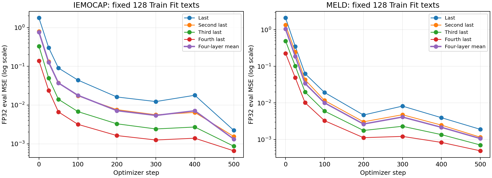
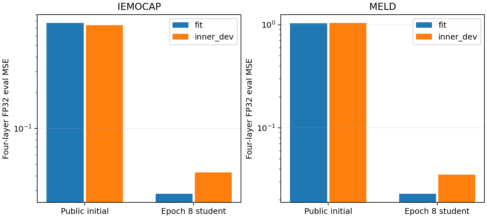

# XP04 双数据集 RoBERTa 蒸馏失败诊断

结论：两套学生能够显著拟合教师表示；受控测试未发现足以解释失败的 Fairseq/HuggingFace 输出差异。上一轮失败最符合“尚未达到特征兼容所需的拟合精度，同时存在泛化差距”。当前证据不能将原因唯一归结为某个优化参数，也不能证明继续蒸馏必然能兼容原始 XP04。

本轮完成三个固定诊断后停止，没有执行第二轮完整蒸馏、官方 Validation/Test 推理、XP04 概率验证或文本干扰。

## 1. 小样本是否能拟合

每个数据集从原有效 Train Fit 固定选择128条不同文本；从相同公开 RoBERTa Large 重新初始化，在新目录训练500个优化步骤。四层 BOS 原尺度 MSE 平均；全编码器可训练，没有分类头、回归映射或情绪标签。

| 数据集 | 初始总体 MSE | 第500步总体 MSE | 相对下降 | 第500步总体 RMSE |
|---|---:|---:|---:|---:|
| IEMOCAP | 0.763013403 | 0.001319679 | 99.8270% | 0.0363274 |
| MELD | 1.043725557 | 0.001062109 | 99.8982% | 0.0325900 |

| 数据集 | 最后一层 MSE | 倒数第二层 | 倒数第三层 | 倒数第四层 |
|---|---:|---:|---:|---:|
| IEMOCAP | 0.002215923 | 0.001541456 | 0.000864200 | 0.000657138 |
| MELD | 0.001893505 | 0.001156309 | 0.000708122 | 0.000490500 |

四层均显著下降，梯度有限且参数确实更新，说明损失与前向/反向链路有效，学生具有较强的目标拟合能力。但500步后仍有可测残差，不能称为精确记忆，也不能说已经达到旧协议逐层 RMSE≤1e-4 的兼容要求。相对初始损失“接近零”与对原始特征空间“数值兼容”是不同判断。

容量测试预先固定 dropout=0、weight decay=0、FP32，区别于旧正式训练的正则化/精度设置。因此较低的小样本损失不能单独证明关闭 dropout 有效，或把差异全部归因于样本量；这不是单因素消融。没有因为中途结果改变步数或参数。

详细记录：[SMALL_SAMPLE_OVERFIT.md](SMALL_SAMPLE_OVERFIT.md)。临时学生保存在各自 `local_only/overfit/{dataset}/final_student/`，原 Epoch 8 学生未修改。

## 2. 框架是否导致明显输出差异

使用同一份实际公开权重，映射进原生官方 Fairseq v0.9.0 编码器。加载后388个功能性 backbone 张量逐值精确相等；HF 额外 token-type embedding 实测全零。每个数据集固定32条 Fit 话语，直接传入相同 Token ID，均 FP32/eval。

- 八组逐层比较全部通过预先冻结的 `allclose(atol=1e-4, rtol=1e-4)`。
- 最大逐层 MAE：`5.093231674e-7`；全局最大绝对误差：`1.335144043e-5`。
- 最低逐层平均余弦：`0.9999999999997743`。

这一误差量级不支持框架实现差异是蒸馏失败的主要原因。结论限定于测试的官方 Fairseq 版本与旧训练 HF 环境；没有证据确认它就是 COSMIC 历史实际版本，也未恢复 CMERC 原微调权重。详细来源、权重映射与逐层结果见 [FRAMEWORK_PARITY.md](FRAMEWORK_PARITY.md)。

## 3. 上一轮是否只是泛化失败

直接加载旧 Epoch 8 最佳学生，用同一 FP32/eval 原损失计算全部旧 Fit 与内部验证；另计算公开初始化基线。没有训练或重新选择模型。

| 数据集 | Fit / 内部验证数量 | 初始化 Fit / 内部验证 MSE | Epoch 8 Fit / 内部验证 MSE | Epoch 8 Dev/Fit |
|---|---|---|---|---:|
| IEMOCAP | 4747 / 536 | 0.770604 / 0.738890 | 0.0282514 / 0.0427956 | 1.5148 |
| MELD | 8989 / 1000 | 1.037708 / 1.039797 | 0.0229422 / 0.0352256 | 1.5354 |

两个数据集 Fit 与内部验证都明显改善，说明旧训练确实学习了目标。内部验证比 Fit 高约51%/54%，存在泛化差距；然而 Fit 本身仍远离数值兼容精度，因而不能只归因于泛化。末两层误差尤其大，详见逐层表。这里的内部验证曾用于旧训练选择 Epoch 8，不能作为新的独立评估集。

旧训练日志中的 dropout/混合精度训练损失与本次 FP32/eval Fit 损失口径不同，不能直接相减。本次重新计算的内部验证误差与旧最佳轮记录差异小于2.6e-10，支持原模型与评估流程可以复现。

详细结果：[TRAIN_DEV_GAP.md](TRAIN_DEV_GAP.md)。

## 4. 主要原因与下一轮判断

1. **学生是否具备拟合能力？** 有较强的近似拟合能力，两套小样本 MSE 均下降超过99.8%；尚未证明能精确拟合至旧兼容门槛。
2. **是否存在明显框架差异？** 在同权重、同输入、FP32 的受控测试中没有发现；因此不把改换框架视为当前主要解决方向。
3. **主要属于哪类失败？** 当前训练方案的拟合精度不足，并伴随泛化差距；不是纯粹“Fit已成功而Dev失败”。这些诊断不足以区分优化步数、正则化、教师目标的可预测性等具体因素各自的因果贡献。
4. **是否值得第二轮蒸馏？** 值得保留一个有条件的、仅在 Train 内开展的优化改进方向，但不建议原样重复完整训练或直接增加Seed。应先定义小样本残差及分组内部验证的明确改善目标，再决定是否投入完整第二轮。当前没有证据保证能达到严格数值兼容，不能据此启用原 XP04 的文本干扰实验。

未进一步调查原生产链或开展额外消融。IEMOCAP 教师历史划分重叠风险沿用既有警示；本轮没有新的证据将它与残差建立因果联系。

## 5. 可追溯性与边界

- 来源版本：`13389ee89abe5f105a4c194659b2c5235a30bcc8`；服务器 `LOCAL_HOST`；本诊断协议先于运行冻结于 `configs/DIAGNOSTIC_PROTOCOL.json`。
- 输入只来自旧 Train 缓存、公开初始化及已保存最佳学生。使用原有 Dialogue 分组 Fit/内部验证，未打开原始共享 pkl、官方 Validation 或 Test，没有读取情绪标签。
- 新代码、实际命令、PID、GPU UUID、环境、运行日志、每步训练 CSV、固定评估点 CSV、权重哈希保存在本目录。图可由 `scripts/plot_diagnostics.py` 从现成 CSV 重新生成，无额外模型推理。
- 最终独立检查记于 `verification.json`，包括26项允许输入的字节数及 SHA-256 不变、真实500步、唯一 Fit 选样、框架权重/指标、全量 Fit/内部验证数量及报告完整性。
- 原始模型、数据及旧学生保持不变；新模型与完整特征留在本地。没有 Git commit 或 push。
