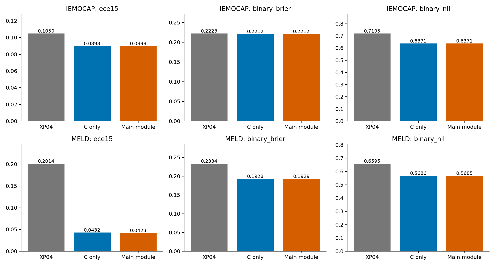

# XP04 统一行为可靠性校准模块：数据结果报告

本次完成 Seed 1475 真正 Validation 的 CPU Pilot。主比较为 **XP04+统一模块 E1_DA 对 XP04**。IEMOCAP 527条/12 Dialogue，MELD 1109条/114 Dialogue。没有重新训练CMERC、GPU前向、新扰动或Test标签使用。

## 直接回答研究目标

**主模块在两个数据集的 ECE15、Binary Brier、Binary NLL 点估计均低于原始 XP04。**但是IEMOCAP所有外层折都关闭了行为分支，提升全部来自基础置信度映射；MELD行为修正的增量微小且不一致。不能把整体校准改善全部归因于随机扰动。

| Dataset | Method | ECE15 ↓ | Brier ↓ | NLL ↓ | Correctness AUC |
|---|---|---|---|---|---|
| IEMOCAP | XP04 | 0.104967 | 0.222303 | 0.719513 | 0.645187 |
| IEMOCAP | E1 | 0.089773 | 0.221210 | 0.637064 | 0.597701 |
| IEMOCAP | L0 | 0.058364 | 0.228836 | 0.674763 | 0.578084 |
| IEMOCAP | E1_MUDELTA | 0.084563 | 0.224643 | 0.647327 | 0.594795 |
| IEMOCAP | E1_DA | 0.089773 | 0.221210 | 0.637064 | 0.597701 |
| IEMOCAP | L0_MUDELTA | 0.061259 | 0.232535 | 0.685670 | 0.571630 |
| IEMOCAP | L0_DA | 0.058364 | 0.228836 | 0.674763 | 0.578084 |
| MELD | XP04 | 0.201363 | 0.233420 | 0.659452 | 0.729885 |
| MELD | E1 | 0.043230 | 0.192764 | 0.568583 | 0.726624 |
| MELD | L0 | 0.025599 | 0.190762 | 0.563799 | 0.726624 |
| MELD | E1_MUDELTA | 0.045294 | 0.193888 | 0.570534 | 0.720617 |
| MELD | E1_DA | 0.042250 | 0.192865 | 0.568505 | 0.725449 |
| MELD | L0_MUDELTA | 0.024813 | 0.192512 | 0.567458 | 0.721068 |
| MELD | L0_DA | 0.023249 | 0.191104 | 0.564499 | 0.725593 |

## 主模块相对XP04的绝对变化

| Dataset | Metric | Δ模块−XP04 | 相对变化 |
|---|---|---|---|
| IEMOCAP | ece15 | -0.015194 | -14.47% |
| IEMOCAP | binary_brier | -0.001093 | -0.49% |
| IEMOCAP | binary_nll | -0.082449 | -11.46% |
| MELD | ece15 | -0.159113 | -79.02% |
| MELD | binary_brier | -0.040556 | -17.37% |
| MELD | binary_nll | -0.090947 | -13.79% |

负数表示指标下降。相对变化是相对原始XP04指标的百分比，不是显著性。Accuracy、Weighted-F1、Macro-F1逐方法保持不变：IEMOCAP为0.660342/0.650208/0.644892；MELD为0.669071/0.661041/0.563809。

## Dialogue配对bootstrap

2000次Dialogue成组抽样，固定种子1475；以下差值为候选方法−参照。区间只描述固定OOF预测的Dialogue采样不确定性，未重拟合嵌套CV。

| Dataset | Candidate | Reference | Metric | Δ | 95% CI |
|---|---|---|---|---|---|
| IEMOCAP | E1_DA | XP04 | ece15 | -0.015194 | [-0.088536, 0.051756] |
| IEMOCAP | E1_DA | XP04 | binary_brier | -0.001093 | [-0.028017, 0.018517] |
| IEMOCAP | E1_DA | XP04 | binary_nll | -0.082449 | [-0.320563, 0.047398] |
| IEMOCAP | E1_DA | E1 | ece15 | 0.000000 | [0.000000, 0.000000] |
| IEMOCAP | E1_DA | E1 | binary_brier | 0.000000 | [0.000000, 0.000000] |
| IEMOCAP | E1_DA | E1 | binary_nll | 0.000000 | [0.000000, 0.000000] |
| MELD | E1_DA | XP04 | ece15 | -0.159113 | [-0.183258, -0.115814] |
| MELD | E1_DA | XP04 | binary_brier | -0.040556 | [-0.051501, -0.029101] |
| MELD | E1_DA | XP04 | binary_nll | -0.090947 | [-0.115020, -0.065143] |
| MELD | E1_DA | E1 | ece15 | -0.000980 | [-0.015101, 0.008633] |
| MELD | E1_DA | E1 | binary_brier | 0.000100 | [-0.000730, 0.000986] |
| MELD | E1_DA | E1 | binary_nll | -0.000078 | [-0.002033, 0.002038] |

MELD相对XP04三项区间均低于0；IEMOCAP三项区间均跨0，12个Dialogue提供的证据有限。对E1的行为增量在MELD没有稳定优势，IEMOCAP则逐行相同。

## 协议与核验

统一结构、数据集分别拟合。外层LODO12/GroupKFold5；每折内部GroupKFold5比较off与λ=1/0.1/0.01，依合并内层OOF Brier选择。每个内层训练子集都重新拟合基础映射、标准化器及4权重offset修正器。详见`EXPERIMENT_PROTOCOL.md`与不可变预登记`preregistration.json`。

独立核验已重建9816条外层预测、163728条内层候选预测，检查1360个内层候选拟合、68个选择决策以及全部14行指标。外层预测重建最大误差约1.31×10⁻¹⁴；原始输入与运行代码哈希均保持一致。E1、L0与历史真正Validation结果精确对齐。

原Validation已经多轮用于方法设计，因此本轮仍是探索性Pilot，不是全新独立确认集。所有负结果与关闭分支的折均保留。数值预检中有一次语法错误和一次L-BFGS线搜索失败；修正后的正式计算使用精确Hessian阻尼Newton，损失/输入/候选λ未改变；失败日志保留，没有按结果调参。

## 产物

`metrics.csv`完整指标；`metric_differences.csv`绝对/相对变化；`oof_predictions.csv`逐话语概率与原始标签/预测/Dialogue ID/Utterance Index；`feature_matrix.csv`逐话语行为输入；`fold_parameters.json`全部内外层参数与分组；`inner_cv_results.csv`全部候选分数；`bootstrap_results.csv`全部区间；`correct_wrong_adjustment.csv`正确/错误置信度变化；`per_dialogue_results.csv`逐Dialogue指标。图在`figures/`。
