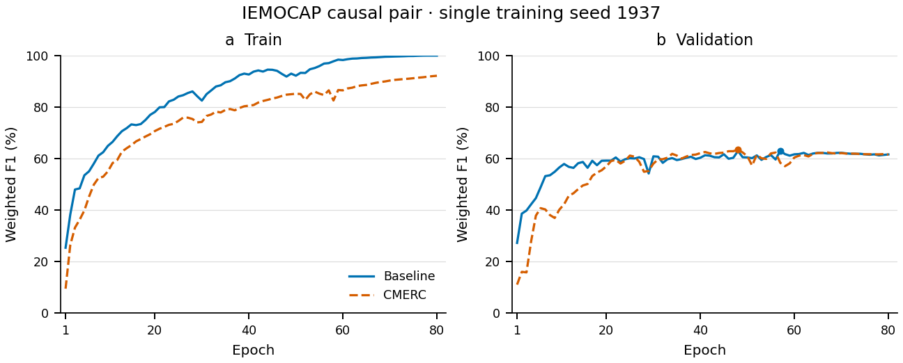

# Causal CMERC 第二轮真实实验

IEMOCAP训练seed1937 / split seed1475，Causal Baseline 80轮 → 真实Causal Difficulty → Causal CMERC 80轮，验证比较冻结后各best一次正式测试。完整状态与结果见[比较报告](BASELINE_VS_CMERC.md)、[验收状态](EXPERIMENT_READINESS.md)和[运行清单](RUN_MANIFEST.json)。

- [冻结协议](EXPERIMENT_PROTOCOL.md)
- [Baseline训练](BASELINE_TRAINING_REPORT.md)
- [Difficulty来源](DIFFICULTY_PROVENANCE_REPORT.md)
- [CMERC训练及加权梯度](CMERC_TRAINING_REPORT.md)
- [Validation三段完整对照](comparison_validation/comparison.md)
- [最终Test三段完整对照](comparison_test/comparison.md)
- [运行命令](COMMANDS.md)与[后续计划](FUTURE_EXPERIMENTS.md)

单seed结果不表示统计显著提升；prefix_mean是前缀平滑，原始特征提取未审计。公开归档仅脱敏汇总/配置/源数据曲线，原始日志、checkpoint、预测与数据留服务器。
